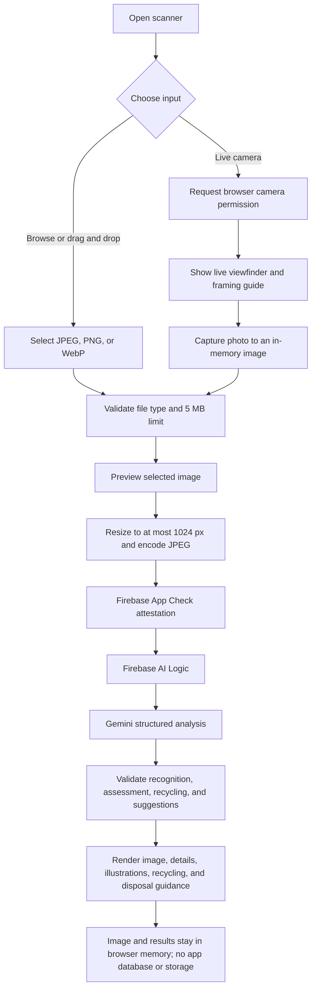
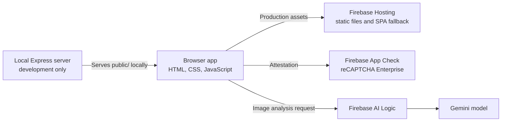

# WasteWise AI

WasteWise AI is a responsive web app that helps people identify everyday waste, explore practical reuse ideas, prepare items for recycling, and find safer disposal guidance. Image recognition and item-specific suggestions are powered by Gemini through Firebase AI Logic.

## Live app

- **Production:** [https://wastewise-836c3.web.app](https://wastewise-836c3.web.app)
- **GitHub:** [github.com/dakshghuge/wastewise](https://github.com/dakshghuge/wastewise)

## What the app does

- **Home:** Navigate the app and browse supported waste categories.
- **Scan waste:** Select or drag in an image, or open the live camera scanner, frame an item, and capture a photo.
- **Image recognition:** See the uploaded image beside the recognized item, category, material estimate, confidence/confirmation notice, visible observations, condition, and reuse outlook.
- **Reuse ideas:** Receive three or four item-specific reuse or safe-recovery suggestions for an AI-analyzed image. Each suggestion includes suitability, materials, difficulty, steps, safety notes, and an illustrative concept graphic.
- **Recycling guide:** Review category-level preparation and acceptance guidance.
- **Item-specific recycling preparation:** For image analysis, review checks and preparation steps tailored to the item, with a reminder that acceptance varies by location.
- **Safer disposal:** See general handling notes, including restrictions for hazardous materials, electronics, broken glass, and uncertain items.
- **Manual category mode:** Select a category without uploading a photo to see bundled guidance and any available curated reuse ideas.
- **Learn:** Browse short educational resources about waste separation, recycling, composting, and reuse.

The app does not provide verified local recycling rules or facility availability. Treat AI output as guidance, check the item yourself, and confirm collection rules with your local waste authority.

## Application workflow



### Image analysis pipeline

1. The user selects a supported image or captures one with the live camera interface.
2. The browser checks file type and size (maximum 5 MB), then creates a local preview.
3. Before analysis, the browser resizes the image so its longest edge is at most 1024 pixels and encodes it as JPEG.
4. Firebase App Check provides a reCAPTCHA Enterprise attestation. Firebase AI Logic sends the image request to Gemini using the configured model.
5. Gemini returns structured data: item recognition, visual assessment, recycling checks and preparation, and three or four tailored ideas.
6. The client validates the response shape, lengths, supported categories, suggestion counts, and restrictions for hazardous/unknown categories.
7. The page renders the result in memory. Reuse concept graphics are locally generated SVG illustrations, not generated or fetched image files.
8. The app does not upload user photos to Firebase Storage or persist analysis results. The image is sent to Google through Firebase AI Logic for AI analysis; see [Privacy and data handling](#privacy-and-data-handling).

### System architecture



Production is a static Firebase Hosting site. There is no production Express API, Cloud Function, Firebase database, authentication, or Firebase Storage integration. `src/server.js` and `src/app.js` only provide a convenient local static server and are not deployed as a backend.

## Technology

- **Frontend:** HTML, CSS, browser JavaScript, hash-based navigation.
- **AI:** Firebase AI Logic with the Gemini Developer API backend; the model ID is configured in `public/assets/js/app.js`.
- **App attestation:** Firebase App Check with reCAPTCHA Enterprise for the production web app.
- **Hosting:** Firebase Hosting, configured in `firebase.json`.
- **Local server:** Node.js and Express, serving the static `public/` directory during development.
- **Build:** esbuild bundles the browser entry point and its Firebase SDK dependencies.
- **Tests:** Node.js built-in test runner (`node:test`).

## Project layout

```text
public/
  index.html                       App shell and page sections
  assets/
    css/styles.css                 Responsive UI and scanner styling
    js/app.js                      Browser app, camera, AI flow, and rendering
    js/app.bundle.js               Generated during build; not checked in
    js/firebase-config.js          Public Firebase web and App Check configuration
src/
  app.js                           Local Express static app
  server.js                        Local development entry point
  config/categories.js             Supported waste categories
  data/guidance.js                 Bundled recycling guides and curated ideas
  services/
    ai/responseValidator.js        AI response and safety validation
    disposalService.js             General safer-disposal guidance
    recommendationService.js       Curated reuse idea filtering
    recyclingService.js            Category recycling guidance
tests/
  api.test.js                      Static app, Hosting, and privacy tests
  services.test.js                 AI validation and guidance tests
firebase.json                      Static Firebase Hosting configuration
.firebaserc                        Default Firebase project alias
package.json                       Scripts and dependencies
```

`public/assets/js/app.bundle.js` is generated from `public/assets/js/app.js` by the build command and is intentionally ignored by Git. The `start`, `dev`, `test`, and Hosting deploy scripts build it before use.

## Requirements

- Node.js 20 or later and npm.
- For Firebase deployment: Firebase CLI, access to the Firebase project, and Firebase AI Logic/App Check configured for that project.
- For camera use: a secure context (HTTPS in production or `localhost` during development), browser camera support, and permission to access a camera.

## Run locally

```powershell
npm install
npm start
```

Open [http://localhost:3000](http://localhost:3000). The start command builds the frontend bundle and launches the local Express static server. To rebuild and restart automatically while editing:

```powershell
npm run dev
```

This builds the bundle and starts the local server in Node watch mode. If you edit browser files under `public/` or shared source imported by the browser, rebuild with `npm run build` to refresh `app.bundle.js`.

The browser app reads Firebase settings from `public/assets/js/firebase-config.js`. The repository's config is for the deployed WasteWise Firebase project. If configuring a separate project, replace the public web-app configuration and App Check site key with values registered for that project.

## Firebase setup

The production site is already configured for the WasteWise Firebase project. To recreate the setup for another project:

1. Create/register a Firebase **Web app** and copy its Firebase web configuration into `public/assets/js/firebase-config.js`.
2. In Firebase Console, set up **Firebase AI Logic** and choose the **Gemini Developer API** backend. Enable the required services and confirm model availability for the project.
3. Configure the model ID in `public/assets/js/app.js`. Model access, availability, and quotas may change; check current Google/Firebase documentation if requests fail.
4. Set up **Firebase App Check** for the web app using a reCAPTCHA Enterprise site key. Register the provider in Firebase Console and configure/enforce App Check for Firebase AI Logic as appropriate.
5. Put the public site key in `appCheckSiteKey` in the Firebase web config. This site key is public browser configuration; do not put a reCAPTCHA secret or Gemini API key in frontend code.
6. Review Firebase and Google Cloud quotas, billing settings, model eligibility, and current Gemini API terms. Firebase Hosting plan and AI usage requirements are separate.

Do not add Gemini API credentials, service-account files, private keys, or reCAPTCHA secret keys to the repository. Firebase web config values and a reCAPTCHA Enterprise **site key** are public identifiers by design; they are not substitutes for App Check, domain restrictions, quotas, and appropriate project security.

### Local App Check development

The production reCAPTCHA key is restricted to the deployed hostnames. Do not loosen those production restrictions just to support localhost. For local AI testing, use Firebase App Check's documented debug provider and register the development debug token in the Firebase Console. Never ship a debug token in the production bundle.

## Tests and build

```powershell
npm test
```

`npm test` first bundles the browser app, then runs the Node.js test files. Tests cover the static app shell and bundle, Hosting configuration, privacy disclosure, structured AI-response validation, safety restrictions, and category guidance.

To only build the browser bundle:

```powershell
npm run build
```

## Deploy to Firebase Hosting

The default project alias is `wastewise-836c3` in `.firebaserc`. Sign in with a Firebase CLI account that has deployment access:

```powershell
firebase login
npm test
npm run deploy:hosting
```

The deploy script rebuilds the browser bundle and deploys **Hosting only** to `wastewise-836c3`. It does not deploy Functions or a server. The production URL is [https://wastewise-836c3.web.app](https://wastewise-836c3.web.app).

## Privacy and data handling

- No sign-in is required; the app does not maintain user accounts or scan history.
- The selected photo and generated result are held in browser memory and are not saved by WasteWise to Firebase Storage or a database.
- When image analysis is requested, the resized image is sent to Google through Firebase AI Logic. Review the current [Gemini API terms](https://ai.google.dev/gemini-api/terms) and [pricing/usage information](https://ai.google.dev/gemini-api/docs/pricing) before using the service or uploading sensitive images.
- Manual category selection does not send an image for AI analysis.
- Camera video is acquired locally in the browser for the live preview and capture. The captured still image follows the same analysis flow as a selected photo.

## Safety and limitations

- Image recognition can be uncertain. Check the photo, material, condition, and any AI-generated suggestion before acting.
- A photo cannot reliably establish coatings, contamination, chemical contents, structural integrity, or whether an item is food-safe.
- For hazardous, electronic, construction, or unknown items, the app prioritizes safe recovery and professional/local guidance over do-it-yourself reuse.
- Do not dismantle batteries/electronics, open unknown chemical containers, or treat the app's general guidance as emergency or professional advice.
- Recycling acceptance, preparation requirements, and collection services vary locally and are not verified by this app.
- The bundled curated reuse library is separate from image analysis; manual selection only shows ideas available in that local catalog.

## Troubleshooting

| Symptom | Checks |
| --- | --- |
| Camera scanner does not start | Use HTTPS or `localhost`, allow camera access, check that a camera is connected, and close other apps using it. Use the file picker as a fallback. |
| AI analysis reports App Check errors | Confirm the site key matches the registered Firebase web app, the production domain is allowed by the reCAPTCHA key, and App Check/Firebase AI Logic enforcement is configured. |
| AI request reports model/API errors | Confirm Firebase AI Logic is enabled, the selected model is currently available to the project, and quotas/region/account eligibility allow requests. |
| Analysis fails validation | Retry with a clear photo of one item. The client rejects malformed or unsafe structured output instead of displaying it as a successful result. |
| Latest frontend changes do not appear | Run `npm run build`, redeploy Hosting, and reload the page. `firebase.json` disables long-lived caching for static assets. |

## License

No license is currently declared in this repository. Contact the repository owner before redistributing or reusing the project.
